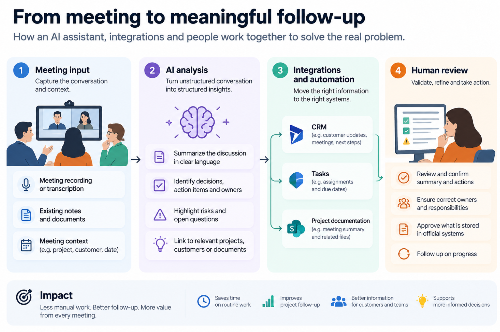

*When building software becomes dramatically easier, the hardest part of digital innovation moves somewhere else.*

**Part 1 of the series: When Building Becomes Easy, What Becomes Hard?**

AI-assisted coding is changing software development at remarkable speed. Applications that once required weeks of development can sometimes be prototyped in hours. People who would never have considered themselves software developers can now build working applications, automate tasks and experiment with AI agents.

This is genuinely exciting. It opens up opportunities for innovation that were previously too expensive, too slow or too dependent on scarce technical expertise.

But it also raises a question:

**If building software is no longer the biggest bottleneck, what is?**

## From a hill to a valley

In discussions with software architects and technology experts, including Gregor Hohpe, I've used a simple metaphor to describe this shift.

Traditionally, the effort involved in developing software could be visualized as a hill.

There was work to do before development: understanding the problem, gathering requirements, making architectural decisions and designing the solution.

Then came the substantial effort of implementation. Writing, debugging and integrating code often represented a major part of the overall workload.

Finally, the software needed to be tested, deployed, adopted, operated and maintained.

The shape wasn't identical in every organization, but coding frequently formed a significant peak in the middle.

**AI is flattening that peak.**

With AI-assisted development, the implementation phase can become dramatically faster. The effort distribution starts to resemble a valley rather than a hill.

The work on either side doesn't disappear.

We still need to understand what customers and employees actually need. We still need to decide whether a new solution is worth building. We still need reliable data, integrations, security, testing, operational support and organizational adoption.

AI can help with many of these activities too. But making code easier to produce does not automatically resolve the business, organizational and architectural questions surrounding it.

The bottleneck moves.

And that changes the economics of digital development.

## The first side of the valley: Are we building the right thing?

In AI ambassador programmes and innovation workshops, I've seen how quickly people can identify opportunities for using AI.

Employees describe repetitive tasks, difficult information searches, manual reporting, frustrating handovers and processes that require information from multiple systems.

These are valuable observations. They often reveal genuine opportunities to improve how an organization works.

But an idea for an AI solution is not necessarily an AI problem.

In an AI ambassador programme, one of the ideas participants raised was automating the work that follows project meetings: preparing meeting notes, identifying action items and updating CRM records.

At first glance, this sounds like an ideal use case for an AI assistant. And part of it is. AI can help interpret unstructured meeting notes, identify decisions and draft follow-up actions.

But the actual business problem is broader. How do those decisions reach the right systems? How are tasks assigned and tracked? Which information should be reviewed by a person before it becomes part of the official project record? And could some of the work already be handled by existing software capabilities?

A working AI-generated meeting summary might be an impressive prototype, but it doesn't necessarily solve the project follow-up problem.

The solution may require a combination of AI, conventional automation, integrations and changes to the way people work.

This is exactly why identifying the problem, and understanding the existing capabilities, matters more than immediately building an AI agent.

Another example is a team struggling to find reliable answers from internal documentation. A retrieval-augmented generation (RAG) solution might help. But perhaps the documents are outdated, inconsistent or poorly structured.

An AI prototype can make these problems less visible without actually solving them.

This is why the ability to distinguish between different types of problems becomes increasingly important.

Before building, we should ask:

- What problem are we actually trying to solve?
- What would improve for the customer, employee or business?
- Is AI the right approach, or would an existing capability, integration, conventional automation or process change work better?
- Has someone already tried to solve this problem?
- What do we need to learn before making a larger investment?

These questions aren't obstacles to innovation.

They help direct experimentation towards opportunities that are worth exploring.

**When building becomes easier, deciding what not to build becomes more valuable.**

## The second side of the valley: A working prototype is not yet a working service

A prototype can demonstrate that something is technically possible.

That is useful, but it is only one kind of evidence.

A prototype doesn't necessarily demonstrate that the solution is reliable, secure, maintainable, economically viable or suitable for real customers.

For example, imagine an AI assistant that can analyze documents and produce convincing summaries.

A demonstration might take a day to build.

But before the assistant becomes part of a professional service, several questions remain:

- Can it access the right information, and only the right information?
- How do we evaluate the accuracy and completeness of its output?
- What happens when it produces an incorrect recommendation?
- Who reviews the results?
- How is confidential information protected?
- How does it fit into existing workflows?
- Who maintains the solution when models, requirements or source documents change?

And perhaps most importantly: **who is accountable for the service and its outcomes?**

These questions matter particularly in industries where trust, confidentiality and professional judgment are central to the customer relationship.

The distinction between a demonstration and a service isn't new. But AI makes it easier to overlook because the demonstration can look surprisingly complete.

A polished interface and a convincing response can create the impression that most of the work is already done.

Sometimes it is. Often, it isn't.

The right response is not to make every experiment follow a heavyweight production process.

Low-risk experiments using synthetic data and isolated environments should be easy to start.

But the requirements should change when an experiment begins using real customer data, connecting to operational systems or affecting actual business decisions.

**Experimentation should be easy. Scaling should be deliberate.**

## When everyone can build, duplication becomes a business risk

There is another consequence of dramatically cheaper software development.

Organizations can suddenly create more software than they can reasonably manage.

Different teams may independently build applications that solve similar problems. Someone purchases a new SaaS tool because it appears faster than extending an existing capability. Another team builds an AI assistant without knowing that a similar experiment was conducted six months earlier.

Each decision can look reasonable in isolation.

Together, they may create overlapping systems, fragmented information, additional integrations, duplicated costs and unclear ownership.

The result is paradoxical: an organization can become faster at building individual solutions while becoming slower at changing its overall digital environment.

This isn't an argument for centralizing every development decision.

It is an argument for making existing capabilities, previous experiments and their lessons easier to discover.

A lightweight check before starting a new experiment can be surprisingly valuable:

**Have we tried this before? Do we already have something that solves it? What is genuinely new about this experiment?**

Sometimes the best next step is to build something.

Sometimes it is to reuse, configure or extend an existing service.

Sometimes it is to stop, because the problem is already solved or the expected value doesn't justify the effort.

All three can be good innovation decisions.

## AI changes the skills that matter

For years, organizations have struggled to access enough software development capacity.

AI doesn't eliminate the need for skilled developers or architects. But it changes where their expertise creates the greatest value.

If producing code becomes faster, other capabilities become relatively more important:

Understanding business problems. Recognizing opportunities for reuse. Evaluating technical and commercial feasibility. Designing sustainable architectures. Validating results. Managing risks. Helping people adopt new ways of working.

This is also why I believe AI ambassador programmes should go beyond teaching people how to use AI tools.

An effective AI ambassador should be able to help colleagues formulate useful hypotheses, distinguish AI opportunities from other improvement needs, design small experiments and evaluate what the results actually demonstrate.

They don't need to become software architects.

But they do need enough understanding of the broader system to recognize when an apparently simple solution depends on data, processes, integrations or organizational changes.

The same applies to leadership.

The question is no longer simply how to increase development capacity.

It is how to improve the organization's capacity to **select, validate, reuse and scale the right solutions**.

## Rethinking the development process around the valley

If the bottleneck has moved, our ways of managing digital development need to evolve as well.

Rather than measuring progress primarily through the number of prototypes, applications or AI experiments, organizations should pay more attention to what those experiments help them learn and improve.

A practical approach doesn't have to be complicated.

**1. Discover the problem.** Understand the customer or business need before committing to a solution.

**2. Check what exists.** Look for existing capabilities, previous experiments, reusable services and available knowledge.

**3. Experiment deliberately.** Test the smallest useful hypothesis with safeguards appropriate to the risk.

**4. Validate the outcome.** Evaluate business value, technical feasibility, reliability and organizational adoption, not just whether the demo works.

**5. Reuse, scale or stop.** Make an explicit decision about what happens next, including ownership and long-term responsibilities.

This isn't a rigid sequence. Teams may revisit earlier decisions as they learn. And the amount of coordination should be proportional to the potential cost and risk.

The point is to make experimentation faster without turning every experiment into another permanent system.

## The real opportunity is bigger than faster coding

I don't see the hill-to-valley shift as a reason to be pessimistic about AI-assisted development.

Quite the opposite.

Making software easier to create is an extraordinary opportunity. It allows more people to participate in innovation, makes previously uneconomical ideas worth testing and gives organizations new ways to solve problems.

But realizing that opportunity requires more than generating working code.

It requires better problem discovery, smarter investment decisions, stronger reuse of existing capabilities and the ability to turn successful experiments into sustainable services.

The organizations that benefit most from AI may not be those that generate the most applications.

They may be the ones that become exceptionally good at recognizing **which applications should exist in the first place**.

**AI is changing the shape of software development. The challenge now is to redesign how we innovate around that new shape.**

---

*This is the first article in the series **When Building Becomes Easy, What Becomes Hard?** In the next article, [Ten AI Experiments. One Business Problem.](/blog/ten-ai-experiments-one-business-problem/), we'll explore why a growing number of AI experiments doesn't necessarily translate into more innovation, and how organizations can learn more while building less.*
