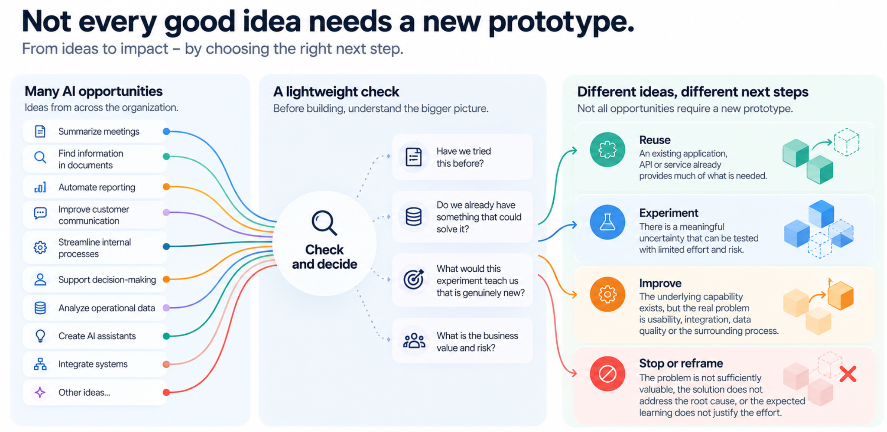

*Why more prototypes don't necessarily mean more innovation, and how organizations can learn faster without building everything.*

**Part 2 of the series: When Building Becomes Easy, What Becomes Hard?**

Imagine an organization launching ten AI experiments.

One team builds an assistant for finding information in internal documents. Another creates an AI-powered reporting tool. A third experiments with automating customer communications. Elsewhere, employees are building small applications, agents and workflow automations.

Within a few weeks, there are ten working prototypes.

The demonstrations are impressive. People are enthusiastic. Leadership sees tangible evidence that the organization is embracing AI.

But six months later, an uncomfortable question emerges:

**What actually changed?**

Perhaps a few people are using the new tools. Some prototypes have been abandoned. Others require more development than expected. Two teams have built similar capabilities without knowing about each other.

And the business problem that originally motivated the experiments may still exist.

This doesn't mean the experiments failed.

It means we need to distinguish between experimenting, learning and innovating.

## AI has changed the economics of experimentation

In the previous article, *[From Hill to Valley: How AI Is Moving the Software Development Bottleneck](/blog/from-hill-to-valley-how-ai-is-moving-the-software-development-bottleneck/)*, I described how AI-assisted development is changing the distribution of effort in software development.

When implementation becomes dramatically faster, activities before and after coding become relatively more important.

The same shift affects innovation.

Traditionally, building a prototype required enough technical effort that organizations had to make choices before committing resources.

Now, an individual or small team can often build something convincing in hours or days.

That's a remarkable opportunity.

It means we can explore ideas that previously wouldn't have justified a development budget. We can test assumptions earlier, involve more employees in innovation and discover possibilities that might otherwise remain invisible.

But cheaper experimentation introduces a new challenge.

**When the cost of starting an experiment falls, the number of experiments can grow faster than the organization's ability to evaluate, learn from and act on them.**

The bottleneck moves from building prototypes to making sense of them.

And unless we change how we manage experimentation, we risk creating a growing collection of demonstrations rather than a growing body of organizational knowledge.

## What are we actually trying to learn?

Consider an AI assistant that summarizes project meetings and identifies action items.

The team builds a prototype. It produces surprisingly good summaries. Everyone agrees that the technology works.

Success?

That depends on the hypothesis.

If the question was whether AI can extract action items from meeting transcripts, the experiment may have provided useful evidence.

But perhaps the original business problem was that project decisions weren't consistently recorded, responsibilities were unclear and follow-up actions were frequently forgotten.

A good summary doesn't necessarily solve any of those problems.

The information still needs to reach the right systems. Responsibilities need to be confirmed. Actions need to be tracked. Existing tools and processes may need to change.

The prototype demonstrated a technical capability, but the business hypothesis remains untested.

This distinction is essential.

An experiment should help answer a question that matters to a decision.

For example:

- Can we reliably extract the information needed for project follow-up?
- Will project managers actually use the proposed workflow?
- Can we connect the solution to existing systems without creating unnecessary complexity?
- Does the new approach reduce manual work or improve the quality of follow-up?
- Is the expected benefit significant enough to justify implementation and ongoing operation?

These are different hypotheses. They may require different experiments.

And not all of them require writing software.

Sometimes a manual simulation, a process trial, a small integration or a test with existing tools can provide better evidence than another AI prototype.

**The goal of an experiment isn't to produce a demo. It's to reduce uncertainty.**

## The experiment that already happened

Here's another situation that becomes more common when experimentation is decentralized.

A team identifies a promising opportunity and starts building.

A few weeks later, someone discovers that another team explored almost the same idea last year.

The earlier experiment didn't lead to production.

Was it a failure? Should the new team stop?

Not necessarily.

Perhaps the technology wasn't mature enough at the time. Perhaps the problem wasn't sufficiently important. Perhaps the experiment uncovered issues with data quality, integration or user adoption.

Those findings could be extremely valuable today.

But only if someone can find them.

Organizations often have inventories of applications and projects. Far fewer have a useful memory of experiments: what was tested, what was learned, why a particular approach was abandoned and what would justify trying again.

This creates an expensive form of organizational amnesia.

The same questions get investigated repeatedly. Teams rediscover known limitations. New tools are purchased to address problems that existing capabilities could already solve.

AI makes this easier to do at scale.

That's why a lightweight knowledge check before starting an experiment can have disproportionate value.

Not an approval committee. Not a lengthy business case.

Just three questions:

**Have we tried this before?**

**Do we already have something that could solve it?**

**What genuinely new thing would this experiment teach us?**

The answers might lead to a new experiment.

But they might also reveal that reusing, configuring or extending an existing capability is a better next step.

And sometimes the most valuable decision is not to build anything.

## Ten experiments can create ten new liabilities

There's another problem with measuring innovation through the number of prototypes.

A successful experiment often creates expectations.

The prototype works. People like it. Someone asks whether it could be used by the whole team. Another person suggests connecting it to customer data. Soon, the demonstration starts becoming part of everyday work.

But who owns it?

Who is responsible for security, privacy, reliability and support? Who monitors its costs? Who updates it when underlying systems or AI models change? Who decides whether it should replace an existing solution?

These questions don't mean the prototype was a bad idea.

They mean the experiment is approaching a different kind of decision.

**Starting an experiment and committing to a permanent capability are not the same investment decision.**

The first is about buying knowledge.

The second is about creating an ongoing responsibility.

Organizations need to make that distinction explicit.

Otherwise, ten experiments can gradually become ten applications, ten sets of dependencies and ten additional things someone needs to maintain.

And what looked like inexpensive innovation can become expensive fragmentation.

## From an experiment pipeline to a learning portfolio

The answer isn't to reduce experimentation to a centrally managed queue.

That would sacrifice one of AI's greatest advantages: the ability to explore ideas quickly and locally.

Instead, I think organizations need to manage experimentation as a portfolio of learning opportunities.

This requires visibility into a few simple things:

**The problem.** What customer, employee or business need are we addressing?

**The hypothesis.** What important uncertainty are we trying to reduce?

**Existing knowledge.** What capabilities, previous experiments or relevant lessons already exist?

**The experiment.** What is the smallest useful test that could provide evidence?

**The outcome.** What did we learn, and what should happen next?

These don't need to become lengthy documents.

A short experiment canvas or a shared record may be enough, especially for low-risk initiatives.

What matters is that learning becomes discoverable and reusable.

And that decisions are made based on evidence rather than the excitement of a successful demonstration.

## Reuse, experiment, improve or stop

I would suggest a simple decision model.

Before starting a new experiment, check whether the problem has already been explored or whether an existing capability can address it.

Then choose the most useful next action.

**Reuse.** An existing application, API, automation or service already provides much of what is needed. Use it, configure it or extend it.

**Experiment.** There is a meaningful uncertainty that can be tested with limited effort and risk.

**Improve.** The underlying capability exists, but the real problem concerns usability, integration, data quality, adoption or the surrounding process.

**Stop or reframe.** The problem isn't sufficiently valuable, the proposed solution doesn't address the root cause or the expected learning doesn't justify the effort.

Notice that only one of these options necessarily involves creating a new prototype.

That is intentional.

If we want to maximize innovation, we shouldn't assume that every promising idea deserves a new application.

Sometimes improving an existing service creates more value than inventing another one.

Sometimes the most innovative decision is to connect capabilities that already exist.

And sometimes stopping early is evidence that the experiment worked exactly as intended.

## Different experiments need different safeguards

A quick experiment using synthetic data in an isolated environment is very different from an AI application processing confidential customer documents.

Both can be valuable.

But they shouldn't require identical processes, nor should they be treated as having identical risks.

The more an experiment affects real customers, operational systems, sensitive data or significant investment decisions, the more important it becomes to clarify responsibilities and validate the relevant risks.

This is not about introducing bureaucracy into every experiment.

It is about matching the level of assurance to the potential consequences.

A low-risk prototype should be easy to start.

Using real customer data requires an appropriate legal and security basis before that processing begins.

Scaling a solution into a business service requires a conscious decision about ownership, integration, support, lifecycle costs and accountability.

The principle is simple:

**Freedom to experiment. Clarity when committing.**

## What should leadership measure instead?

If the number of experiments isn't enough, what should organizations pay attention to?

I would start with four questions.

**Are we learning faster?**

How quickly can we test an important assumption and reach a useful decision?

**Are we reusing what we already know and have?**

Do new initiatives benefit from previous experiments, existing applications, APIs, data products and organizational knowledge?

**Are we creating measurable business value?**

Do experiments lead to improvements in customer experience, employee productivity, service quality, revenue or other meaningful outcomes?

**Are we making deliberate commitments?**

When an experiment becomes a service, are its costs, responsibilities and dependencies understood?

These questions provide a more useful view of innovation capacity than simply counting prototypes.

An organization that runs three experiments and makes three well-informed decisions may be learning more than one that launches thirty demos and never evaluates what happened.

Of course, the opposite can also be true. A broad range of small, inexpensive experiments may be exactly what is needed when uncertainty is high.

The point isn't to optimize the number of experiments up or down.

It's to maximize the value of what the organization learns and does as a result.

## Innovation capacity is not the same as development capacity

AI is giving organizations access to an extraordinary amount of new development capacity.

That is worth celebrating.

But development capacity and innovation capacity are not interchangeable.

Innovation also requires the ability to recognize meaningful problems, combine existing capabilities, make informed choices, coordinate change and turn learning into results.

Those capabilities don't automatically expand when code becomes easier to generate.

In fact, they can become the new constraints.

This is why the most important AI transformation may not be happening inside the code editor.

It may be happening in how organizations discover opportunities, share knowledge, evaluate experiments and decide what deserves to become a lasting capability.

**The question is no longer simply: How many AI experiments can we run?**

**It's: How much better can we become at solving the problems that matter?**

---

*This is Part 2 of **When Building Becomes Easy, What Becomes Hard?**, a series exploring how AI is changing software development, experimentation and digital innovation.*

*In Part 1, **[From Hill to Valley: How AI Is Moving the Software Development Bottleneck](/blog/from-hill-to-valley-how-ai-is-moving-the-software-development-bottleneck/)**, we explored how AI shifts the effort from implementation towards the work surrounding it.*

*Next: **[Not Every Problem Needs an AI Agent](/blog/not-every-problem-needs-an-ai-agent/)**, why recognizing the right type of problem may be one of the most valuable skills in the AI era.*
